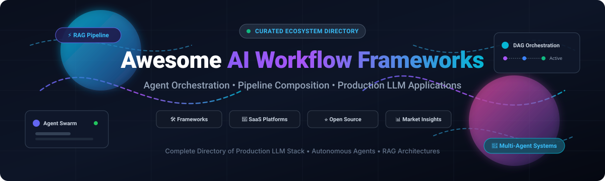

# ⚡ Awesome AI Workflow Frameworks 🤖

### 🌟 Production LLM Application Architecture, Agent Orchestration & Pipeline Composition Ecosystem 🚀

  
  
  
  
  
  
  

  <b>A curated list of leading Enterprise SaaS platforms, Developer Tools, and Open-Source GitHub Projects for orchestrating AI agents, building Retrieval-Augmented Generation (RAG) pipelines, and deploying production-grade LLM applications.</b>

---

## 📑 Table of Contents
- [📌 Sector Overview & Market Dynamics](#-sector-overview--market-dynamics)
- [☁️ SaaS & Hosted Platforms](#️-saas--hosted-platforms)
- [💻 Open-Source GitHub Frameworks](#-open-source-github-frameworks)
- [📈 Star History](#-star-history)
- [🤝 How to Contribute](#-how-to-contribute)
- [💖 Support & Sponsorship](#-support--sponsorship)
- [⚠️ Disclaimer](#️-disclaimer)

---

## 📌 Sector Overview & Market Dynamics

The global AI workflow and agent orchestration market was estimated between **$8.7B and $13.9B in 2025**, projected to reach **$11.7B to $13.7B in 2026** and surge past **$28B–$30B+ by 2030** at an accelerated CAGR of **22.3% to 35%+**. 

The sector remains **highly fragmented** rather than a winner-take-all monopoly, marked by fierce convergence among hyperscalers (Microsoft Copilot Studio, Google Cloud, AWS), enterprise workflow giants (ServiceNow, Workday), and open-source foundation ecosystems (LangChain, AutoGen, CrewAI, Dify). Emerging standards around agent memory, multi-agent protocols, and durable DAG execution continue to keep the landscape modular and distributed.

---

## ☁️ SaaS & Hosted Platforms

A quantitative breakdown of commercial, hosted, and enterprise AI workflow orchestration platforms, ordered by company scale and capitalization.

| Company / Product | Company Scale (Revenue / Valuation) | Starting Tier Pricing | Free Tier / Trial Limits | Core Capabilities & Focus |
| :--- | :--- | :--- | :--- | :--- |
| **[AutoGen Studio (Microsoft)](https://microsoft.github.io/autogen/)** | **~$3.1T Market Cap** (Microsoft) / $245B+ ARR | **Included with Azure consumption** (Azure OpenAI usage rates apply) | **$200 free credit** (30-day Azure Free Trial) | Microsoft's enterprise multi-agent suite. Graphical interface for prototyping, testing, and monitoring multi-agent conversational teams. |
| **[LangFlow Cloud (DataStax)](https://www.langflow.org/)** | **~$1.6B Valuation** (DataStax acquired by IBM/Private Equity) | **Pay-As-You-Go** starting at **$0.37 / million read units** (Astra DB backend) | **$25/month free recurring credit** (covers up to 5 serverless databases & millions of operations) | Visual drag-and-drop IDE for building multi-agent workflows, tool routing, and RAG pipelines with integrated vector databases. |
| **[LangSmith (LangChain Inc.)](https://smith.langchain.com/)** | **$1.25B Valuation** (Series B unicorn) / ~$15M ARR | **$39 / seat / month** (Plus Plan) | **Free forever Developer plan**: 1 user seat, 5,000 base traces/month (14-day retention), and debugging playground | Category-defining LLM observability, agent tracing, dataset management, prompt iteration, and automated evaluations. |
| **[Dify Cloud (LangGenius)](https://dify.ai/)** | **$180M Valuation** (Series Pre-A) / ~$4M ARR | **$59 / workspace / month** (Professional Plan) | **Free forever Sandbox plan**: 1 workspace, 1 user, 200 platform message credits, 5 apps, 50 docs (50 MB storage) | Turnkey LLMOps platform featuring visual agentic workflow orchestration, document RAG, and multi-model deployment. |
| **[CrewAI Enterprise](https://www.crewai.com/)** | **$50M–$100M Valuation** / ~$3M ARR | **$99 / month** (AWS Marketplace self-serve Starter) | **Free forever Hosted Plan**: 1 user, 50 workflow executions/month, visual workflow builder & GitHub sync | Role-based autonomous agent orchestration platform with multi-agent delegation, production tracing, and team collaboration. |
| **[Flowise Cloud](https://flowiseai.com/)** | **Acquired by Workday** / ~$1M ARR | **$35 / month** (Starter Plan) | **Free forever plan**: 2 flows & assistants, 100 predictions/month, 5 MB storage, and community support | Low-code/no-code drag-and-drop interface for composing LangChain components, agent swarms, and conversational chatbots. |

---

## 💻 Open-Source GitHub Frameworks

The definitive open-source AI workflow frameworks, agent runtimes, and pipeline composition libraries, ranked by community adoption (**descending GitHub Stars**).

| Repository & Framework | Community Stars | License | Core Strengths & Architectural Specialty |
| :--- | :---: | :---: | :--- |
| **[n8n](https://github.com/n8n-io/n8n)** |  | Sustainable Use License | Enterprise workflow automation platform with native AI nodes, LangChain connectors, vector memory, and 400+ SaaS integrations. |
| **[AutoGPT](https://github.com/Significant-Gravitas/AutoGPT)** |  | MIT | The pioneering autonomous agent harness capable of breaking complex goals into multi-step actions, tool calls, and continuous self-correction. |
| **[Dify](https://github.com/langgenius/dify)** |  | Apache-2.0 w/ cond. | Complete open-source LLM application platform featuring visual DAG workflow builders, prompt engineering studios, and multi-tenant RAG pipelines. |
| **[Langflow](https://github.com/langflow-ai/langflow)** |  | MIT | Highly visual, modular drag-and-drop framework for architecting multi-agent ecosystems, custom tools, and RAG retrieval networks. |
| **[LangChain](https://github.com/langchain-ai/langchain)** |  | MIT | Industry-standard developer harness and ecosystem. Provides standard abstractions, chains, LangGraph durable agent state graphs, and tool bindings. |
| **[browser-use](https://github.com/browser-use/browser-use)** |  | MIT | Autonomous agent framework designed specifically for browser automation, web interaction, scraping, and human-like web actions. |
| **[RAGFlow](https://github.com/infiniflow/ragflow)** |  | Apache-2.0 | Next-generation open-source RAG engine based on deep document understanding and multi-agent workflow orchestration. |
| **[MetaGPT](https://github.com/geekan/MetaGPT)** |  | MIT | Multi-agent collaboration framework that simulates complete software teams (Product Managers, Architects, Project Managers, Engineers) with structured SOPs. |
| **[AutoGen](https://github.com/microsoft/autogen)** |  | MIT | Microsoft's multi-agent conversational framework enabling cooperative autonomous agents, human-in-the-loop validation, and dynamic tool orchestration. |
| **[CrewAI](https://github.com/crewAIInc/crewAI)** |  | MIT | Ergonomic, role-based multi-agent orchestration framework. Define agents with dedicated backstories, goals, tools, and execution processes. |
| **[Flowise](https://github.com/FlowiseAI/Flowise)** |  | Apache-2.0 | Accessible UI/visual graph canvas for assembling LangChain components, agent tool callers, and conversational bots. |
| **[LlamaIndex](https://github.com/run-llama/llama_index)** |  | MIT | The premier data framework for connecting external data sources, indexing knowledge bases, and executing contextual retrieval workflows. |
| **[Agno](https://github.com/agno-agi/agno)** |  | Apache-2.0 | Ultra-fast, lightweight full-stack framework (formerly Phidata) for building multi-modal autonomous agents with memory and knowledge integration. |
| **[DSPy](https://github.com/stanfordnlp/dspy)** |  | MIT | Stanford framework for programmatically optimizing and compiling LM prompts and weights using algorithmic teleprompters rather than manual prompting. |
| **[smolagents](https://github.com/huggingface/smolagents)** |  | Apache-2.0 | Hugging Face's minimalist library where agents execute actions via raw Python code blocks instead of JSON tool formats. |
| **[Semantic Kernel](https://github.com/microsoft/semantic-kernel)** |  | MIT | Enterprise-grade SDK from Microsoft supporting C#, Python, and Java for fusing AI plugins, planners, memory, and copilot infrastructure. |
| **[Vercel AI SDK](https://github.com/vercel/ai)** |  | Apache-2.0 | TypeScript/JavaScript standard library for building streaming AI chat, generative UI, and agent workflows across web frameworks. |
| **[Haystack](https://github.com/deepset-ai/haystack)** |  | Apache-2.0 | Production NLP orchestration framework by deepset featuring strongly-typed DAG pipelines, state-of-the-art retrieval, and evaluation metrics. |
| **[Letta](https://github.com/letta-ai/letta)** |  | Apache-2.0 | Stateful LLM architecture (formerly MemGPT) that manages self-editing hierarchical memory systems across unlimited conversational sessions. |
| **[Swarm](https://github.com/openai/swarm)** |  | MIT | Educational, lightweight multi-agent orchestration pattern from OpenAI emphasizing handoffs and routine execution primitives. |
| **[Pydantic AI](https://github.com/pydantic/pydantic-ai)** |  | MIT | Type-safe agent framework created by the Pydantic team, bringing validation, structured streaming, and dependency injection to LLM agents. |
| **[CAMEL](https://github.com/camel-ai/camel)** |  | Apache-2.0 | Communicative Agent Framework studying cooperative "mind" exploration, automated role-playing, and scalable autonomous social simulations. |
| **[Griptape](https://github.com/griptape-ai/griptape)** |  | Apache-2.0 | Python framework for composable, typed DAG workflows and pipelines with off-the-shelf FastAPI deployment and cloud hosting drivers. |

---

## 📈 Star History

---

## 🤝 How to Contribute

Contributions are welcome! If you know an outstanding AI workflow framework or orchestration tool that should be included:

1. 🍴 **Fork** this repository.
2. 🌿 **Create a new branch** (`git checkout -b add-my-framework`).
3. 📝 **Add your entry** adhering to the existing tabular format (include link, license, and precise capability breakdown).
4. 🚀 **Commit your changes** (`git commit -m "feat: add FrameworkName"`).
5. 📤 **Push to branch** (`git push origin add-my-framework`).
6. 🎯 **Open a Pull Request** with a brief summary of why it belongs here.

---

## 💖 Support & Sponsorship

If you find this curated ecosystem directory helpful for your AI architecture, team, or projects, please consider supporting the project:

- ⭐ **Star this repository** on GitHub to increase visibility!
- 🍴 **Fork & Share** with fellow AI engineers and builders.
- ☕ **Buy me a coffee / Sponsor**: Show your support via [GitHub Sponsors Dashboard](https://github.com/sponsors/ishandutta2007).

---

## ⚠️ Disclaimer

- This repository is a **community-curated index** provided for informational and educational purposes; listing does not constitute an explicit commercial endorsement.
- All trademarks, logos, and brand names belong to their respective owners.
- When deploying AI workflow and agent frameworks in enterprise production, verify compliance with data privacy regulations (GDPR, CCPA, HIPAA), safety guardrails, and model provider service terms.

---

  Maintained with ❤️ by <a href="https://github.com/ishandutta2007">Ishan Dutta</a> and the global open-source community.

